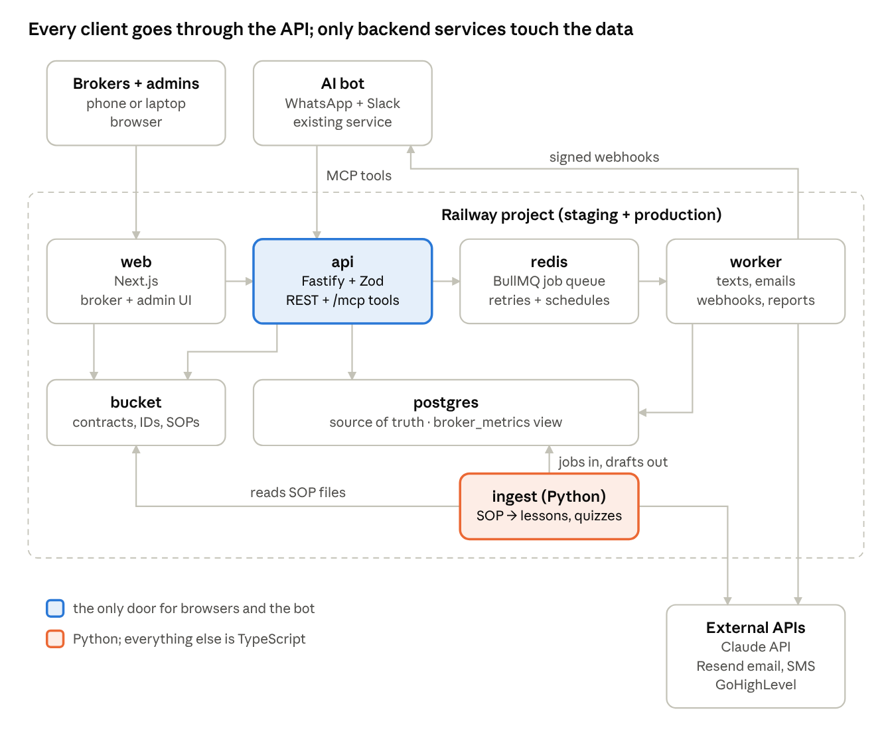
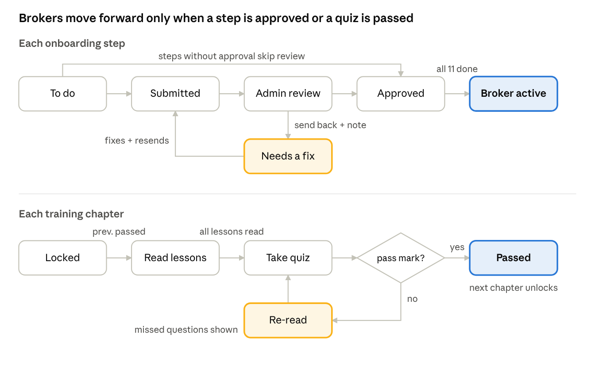
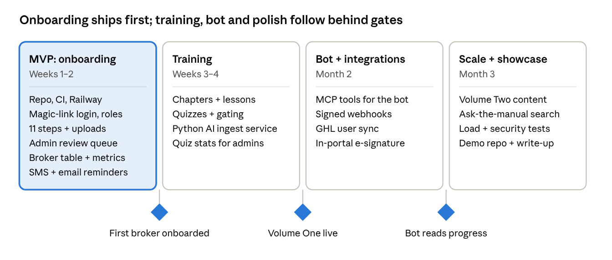

# 365 Broker Portal — Software Architecture

Oct 17, 2026 · Aj

> For the weekend MVP, `docs/SPEC.md` is the source of truth. This document is the long-term plan; the MVP builds a subset of it (no Redis, worker, Python ingest service, MCP endpoint, SMS or magic links yet). Where the two differ, SPEC.md wins.

**Recommendation:** one monorepo deployed to Railway as four services on a single Postgres database: a web app, an API and a background worker in TypeScript, plus one Python service that turns SOP documents into lessons and quiz drafts. The API is the only thing that talks to the database for clients, so the web app, the AI bot and any future dashboard all go through the same rules.

## Goals and constraints

| Constraint | What it means for the design |
| --- | --- |
| MVP live in 1–2 weeks | Build only what new brokers touch first: onboarding steps, uploads, approvals, Volume One chapters and quizzes. Everything else is phase 2. |
| Brokers are not tech-savvy | One next action per screen, SMS reminders, magic-link login (no passwords to forget), works on a phone. |
| Admins need tracking | Every status change is stored with who and when, so the dashboard numbers are queries, not manual entry. |
| Metrics in SQL, shareable | Broker metrics (active, joined, onboarded, tenure, junior/senior) live in a SQL view other tools can read directly. |
| Hosted on Railway | Postgres, Redis and file storage all run as Railway services in the same project. |
| AI bot later | The API exposes the same actions as MCP tools, so the WhatsApp/Slack bot can read progress and nudge brokers without new plumbing. |
| Strong CV project | Production patterns a big-tech reviewer recognises: typed contracts, migrations, background jobs, audit log, tests, CI/CD, observability. |

## Architecture at a glance

Browsers and the bot only ever call the API. The browser uploads files straight to the bucket using a URL the API signs. Anything slow or external — texts, emails, AI drafting, GHL updates, webhooks back to the bot — goes on the Redis queue and runs in the worker. SOP documents go to the Python `ingest` service, which reads the file from the bucket, calls Claude, and writes draft lessons and questions back to Postgres for an admin to review.

## Tech stack

TypeScript for the web app, API and worker, because the AI bot and the GHL MCP server are already Node, so code and types can be shared. Python for one job only, document ingestion, where its libraries are strongest.

| Layer | Choice | Why |
| --- | --- | --- |
| Repo | pnpm workspaces + Turborepo; the Python service managed with uv | One repo, shared types between web, API, worker and bot; cached builds. |
| Web app (broker + admin) | Next.js (App Router), React, Tailwind + shadcn/ui | One app with two route groups (`/app` for brokers, `/admin`), themed in 365 blue and white from the mockups. |
| API | Fastify + Zod, OpenAPI generated from the schemas | Fast, typed request validation; the OpenAPI spec doubles as docs and generates the web client. |
| Database | Postgres (Railway) + Drizzle ORM and migrations | SQL-first, typed queries, versioned migrations checked into git. |
| Background jobs | BullMQ on Railway Redis, run by the worker service | Reminders, notifications and reports run outside the request path. |
| Document ingestion | Python 3.12 `ingest` service: FastAPI, PyMuPDF, Pydantic | Python has the best PDF and text-processing libraries. It takes SOP files and writes draft lessons and questions back to Postgres. |
| File storage | Railway Storage Bucket (S3-compatible), presigned uploads | Contracts and IDs never pass through the API; bucket stays private. |
| Auth | Better Auth: magic link by email or SMS code, sessions in Postgres | No passwords for brokers; admins can add 2FA. |
| Notifications | Resend (email) + SMS through GoHighLevel or Twilio | 365 already pays for GHL; SMS is what brokers actually read. |
| AI | Claude API with structured output; pgvector for search | Drafts quiz questions from SOPs; the same index later powers "ask the manual" in the bot. |
| Observability | Pino logs, Sentry, OpenTelemetry traces | Errors and slow requests visible from day one, in both languages. |
| Tests and CI | Vitest, pytest, Playwright, GitHub Actions | Unit, API and end-to-end tests run on every pull request before Railway deploys. |

## Railway setup

One Railway project, two environments (`staging`, `production`), seven services. Services talk over Railway's private network; only `web` and `api` get public domains.

| Service | What it runs | Public? |
| --- | --- | --- |
| `web` | Next.js app, e.g. `team.365yachts.org` | Yes |
| `api` | Fastify API + `/mcp` endpoint for the bot, e.g. `api.365yachts.org` | Yes |
| `worker` | BullMQ jobs: reminders, notifications, webhooks, nightly metrics refresh | No |
| `ingest` | Python service: SOP files in, draft lessons and quiz questions out | No |
| `postgres` | Source of truth; daily backups enabled | No |
| `redis` | Job queue and rate limiting | No |
| `bucket` | Contracts, IDs, W-9s, headshots, SOP files, lesson videos | No — files served by short-lived presigned URLs |

- **Deploys:** GitHub pushes to `main` deploy to staging; a tagged release promotes to production. Migrations run as a pre-deploy command, so a failed migration blocks the deploy. Service settings are entered in the Railway dashboard (see `docs/DEPLOY.md`), because Railway has deprecated `railway.json` config files for new services.
- **Secrets:** Railway variables, shared with reference variables (`${{Postgres.DATABASE_URL}}`), never in git.
- **Files:** Railway buckets are private and S3-compatible, support presigned URLs, and give each environment its own bucket. The browser uploads straight to the bucket; the API only signs the URL and records the file.
- **Cost control:** staging services can sleep when idle; storage is billed per GB-month.

## Data model

The onboarding steps and chapters are **templates** stored as data, and each broker gets their own **progress rows**. Shelly can change a step or a quiz without a code deploy, and old progress stays intact.

| Table | Key columns | Purpose |
| --- | --- | --- |
| `users` | id, name, email, phone, role (`broker` / `admin` / `owner`) | Anyone who logs in |
| `brokers` | user_id, level (`junior` / `senior`), status (`invited` / `onboarding` / `active` / `inactive`), joined_at, onboarded_at, left_at, commission_tier, persona_md, ghl_user_id | The fields Max asked for live here |
| `onboarding_steps` | stage, position, title, kind (`upload` / `sign` / `form` / `confirm` / `meeting`), needs_approval, instructions, video_url, version | The 11-step template |
| `broker_steps` | broker_id, step_id, status, submitted_at, reviewed_by, reviewed_at, review_note | One row per broker per step |
| `files` | broker_step_id, storage_key, file_name, size, version | Every uploaded document, never overwritten |
| `chapters` | volume, code, title, position, pass_mark, questions_per_attempt, status (`draft` / `live`) | Modules from the manual |
| `lessons` | chapter_id, position, title, body (markdown), video_url, read_minutes | Chapters split into short lessons |
| `lesson_progress` | broker_id, lesson_id, completed_at | Gates the quiz |
| `questions`, `question_options` | chapter_id, lesson_id, prompt, explanation, source (`ai` / `human`), is_correct | The question bank |
| `quiz_attempts`, `attempt_answers` | broker_id, chapter_id, score_pct, passed, answers | Every attempt kept, for per-question stats |
| `ingest_jobs` | file, status, error, created_at | Hand-off from the API to the Python ingest service |
| `audit_log` | actor, action, entity, before, after, at | Who changed what, when |
| `outbox_events` | type, payload, processed_at | Events the worker turns into texts, emails and bot webhooks |

**Broker metrics view.** `broker_metrics` is a SQL view that computes, per broker: active or not, date joined, date onboarded, days to onboard, time with us (tenure in days), junior or senior, steps approved, chapters passed and average first-attempt quiz score. Nothing is stored twice, so it can never go out of date.

**Sharing with other platforms.** A read-only Postgres user can query `broker_metrics` from Metabase, Google Sheets or the KPI dashboard. The API also serves it for the bot.

**Personas.** Each broker has one free-text persona (`persona_md`), admin-only, used for matching leads to brokers with a shared background (for example veteran to veteran).

## Core flows

Both flows are small state machines in one shared package, so the web app, the API and the tests all use the same rules. When the last onboarding step is approved, the API sets the broker to `active`, stamps `onboarded_at` and unlocks Part 0. Every transition writes to `audit_log` and emits an event, which is how the admin overview and the bot know who is stuck.

## Content pipeline: SOP to chapters to quizzes

AI drafts the questions and a human publishes them. No question reaches a broker until an admin approves it.

1. **Import.** Admin uploads an SOP (PDF or Google Doc) or pastes text. The API saves the file and adds a row to an `ingest_jobs` table. The Python `ingest` service picks it up (BullMQ is Node-only, so a Postgres job table is the hand-off between the two languages), extracts the text and keeps the original file.
2. **Split.** Claude proposes lesson breaks of 2–4 minutes each, keeping the manual's numbering (Module 02 stays 02) and the WATCH / NEVER / HOUSE RULE callouts as styled blocks. Admin adjusts in the editor.
3. **Draft questions.** For each lesson, Claude returns 3–5 multiple-choice questions as structured JSON: prompt, four options, the correct one, an explanation and the lesson it came from. Questions must be answerable from the lesson text alone.
4. **Review.** Drafts land as `draft`. Admin edits, approves or deletes each one.
5. **Publish.** The chapter goes `live`. Each attempt draws a random set (e.g. 8 of 12) so brokers can't share answer lists.
6. **Improve.** Per-question correct rates show which lessons are unclear. A question most brokers miss usually means the lesson needs rewriting.

The same lesson text is embedded into pgvector once, which is what lets the bot answer "what bond does a salesperson need?" later.

Figures in the manual that DBPR sets (fees, bond amounts) are flagged in the editor with a "verify before publishing" note, as the manual itself asks. The disputed co-broke example in Module 03 stays out of the quiz until Shelly confirms the numbers.

## Auth, roles and security

Permissions are enforced in the API on every request, not hidden in the UI. This is the same rule the bot already follows for GHL data.

| Role | Can do |
| --- | --- |
| Broker | See and submit only their own steps, files, lessons and attempts |
| Admin (Shelly, sales execs) | Review submissions, manage brokers, edit steps, chapters, questions and personas |
| Owner (Max, Aj) | Everything, plus settings, roles and data export |
| Bot (service account) | Read progress and metrics; send nudges; no access to file contents |

- **Login:** an invite link from the admin, then magic links by email or a 6-digit SMS code. Admin accounts add an authenticator app. (MVP: invite link + password.)
- **Defence in depth:** Postgres row-level security on broker-owned tables as a second lock, so a bug in one endpoint can't leak another broker's W-9.
- **Sensitive files:** IDs, W-9s and contracts hold tax IDs and addresses. The bucket is private, links expire after a few minutes, every download is written to `audit_log`, and files of brokers who leave are kept or deleted per a retention rule Max sets.
- **Input safety:** Zod validation on every endpoint, file type and size checks, rate limits on login and uploads.
- **Bot access:** a separate scoped API key, rotatable, logged like any other user.

## Integrations

The bot connects the same way it already connects to GHL: through MCP tools served by our own API.

**AI bot (WhatsApp / Slack).** The API exposes an `/mcp` endpoint with a small set of tools, all permission-checked like any other request:

- `get_my_onboarding` — a broker asks "what's left?" on WhatsApp and gets their next step.
- `get_broker_progress` and `list_stuck_brokers` — leadership asks "who's stuck?" and gets names and blockers.
- `get_broker_metrics` — feeds the morning digest and broker performance reviews.
- `search_manual` — answers questions from the published lessons, citing the chapter.
- `send_nudge` — the bot reminds a broker about a pending step.

The API also fires signed webhooks (`step.submitted`, `step.approved`, `broker.onboarded`, `quiz.failed`) so the bot can react without polling: for example, texting Shelly when a W-9 arrives.

**GoHighLevel.** When a broker becomes `active`, the worker can create or update their GHL user and tag them, so lead routing only sends leads to onboarded brokers. MVP: a manual "mark as set up in GHL" step; automation in phase 2.

**E-signature.** MVP: the contract and NDA are signed outside the portal and the signed PDF is uploaded, as now. Phase 2: an e-signature API (Dropbox Sign, DocuSign, or self-hosted Documenso on Railway) so signing happens in the step itself.

**Email and SMS.** Resend for email; SMS through GHL's API or Twilio. Every message is a queued job with retries, so a provider outage delays texts instead of losing them.

## Quality: testing, CI/CD, observability

Nothing reaches production without passing CI, and every error in production reaches you before a broker complains.

- **Unit tests (Vitest):** the step state machine, quiz scoring, unlock rules and the metrics view. These are pure functions, so they are fast and exact.
- **API tests:** run against a throwaway Postgres in CI (Docker), covering permissions: a broker must never read another broker's data.
- **End-to-end (Playwright):** a broker completes onboarding and passes a quiz; an admin approves and sends back a submission.
- **CI (GitHub Actions):** lint, typecheck, tests and a migration dry-run on every pull request. Merge to `main` deploys staging; a release tag deploys production.
- **Observability:** structured Pino logs with a request id, Sentry for errors in web, API and worker, OpenTelemetry traces for slow queries, and a `/health` endpoint Railway checks.
- **Backups:** Railway Postgres backups plus a monthly test restore into staging.

## Build plan

The MVP is only onboarding plus admin tracking, so new brokers can use it within two weeks. Each phase starts only after its gate is met with real brokers, not just when the code is finished.

## Making it CV-worthy

Recruiters look for real users, measurable impact and sound engineering decisions you can explain.

- Record the baseline now: how long onboarding takes today, how many docs get chased by hand. The portal then reports days to onboard, review turnaround and quiz pass rates automatically.
- Keep the real repo private and publish a sanitised demo version with fake data, the architecture diagram, and a short design note on why templates vs progress rows, why the outbox pattern, and why row-level security.

## Open questions for Max

- Who approves submissions: only Shelly, or any sales executive?
- Which steps need approval and which are just "done" when the broker confirms?
- Do junior and senior brokers get different steps or chapters?
- Pass mark (80%?), questions per attempt, and what happens after two fails?
- SMS through GHL or a separate Twilio number?
- E-signature in phase 2: paid provider or self-hosted Documenso?
- How long do we keep IDs and W-9s after a broker leaves?
- Is Module 03's co-broke example ($15,000 vs $7,500) confirmed?
- Domain: `team.365yachts.org` or another?
